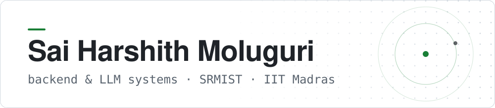
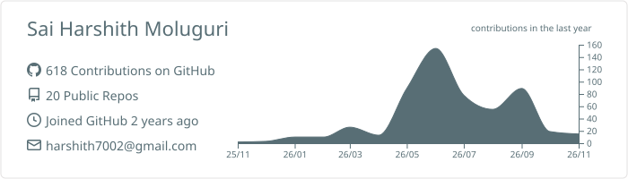
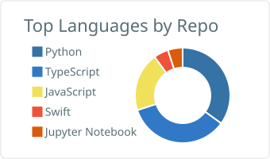
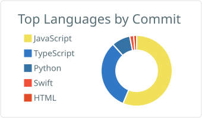

<picture>
  <source media="(prefers-color-scheme: dark)" srcset="assets/header-dark.svg">
  
</picture>

I'm a B.Tech Computer Science student at SRM Institute of Science and Technology, and I'm also doing the BS in Data Science and Applications at IIT Madras alongside it. I'm based in Hyderabad.

I mostly build where a backend meets a language model: the API, the data model, the auth, and the awkward cases. Those include a tool call that comes back late, a user who changes their mind halfway through, or a model that isn't available on the day of the demo. I care more about something working end to end than about how it looks in a screenshot.

[LinkedIn](https://www.linkedin.com/in/sai-harshith-moluguri-892679324/) · [Email](mailto:saiharshithm2024@gmail.com) · [Roast My Resume (live)](https://roast-my-resume-two.vercel.app)

---

### What I work on

- **Full-stack apps.** React and Next.js on the front, with Flask, FastAPI or Spring Boot behind them.
- **LLM applications.** Groq, Gemini and Claude APIs, plus local models through Ollama when data can't leave the machine.
- **Agents and tool calling.** MCP-style tool routing, and keeping agent state correct when things happen out of order.
- **Backend fundamentals.** Service boundaries, JWT and TOTP auth, encryption at rest, audit logs that detect tampering.
- **ML experiments.** Fine-tuning and quantizing transformers, measuring the results before making claims about them.

---

### Selected work

**[Macoostudy (Roast My Resume)](https://github.com/harshith7002/Macoostudy)** · [live](https://roast-my-resume-two.vercel.app) 
Resume review that explains its score. It rates a PDF in five categories, matches it against a job description and rewrites weak bullet points. The category scores are computed in the backend; the LLM writes the feedback, it doesn't decide the number. It runs on Supabase Postgres in production and SQLite locally, with a Razorpay paid tier and PDF export. 
React · Flask · Groq · PostgreSQL · Razorpay

**[CHRONOS](https://github.com/harshith7002/CHRONOS)** 
A control plane for AI agents that can be interrupted. It versions the user's intent, invalidates only the work that depended on what changed, rejects tool results that arrive after they're stale, and blocks irreversible actions until they're confirmed and idempotent. Seven invariants are checked by a 2,000-run fault-injection suite against a naive baseline. Gemini, Claude and OpenAI providers plug in, and there's an MCP client. 
Python · FastAPI · pytest · Docker

**[Veridoc Secure DMS](https://github.com/harshith7002/veridoc-secure-dms)** 
Case-file management for police and legal records (SIH 2026, PS 26190). It's six FastAPI services behind a gateway. Features:
- A hash-chained audit ledger that catches edited rows.
- AES-256-GCM encryption at rest.
- Role-based access with TOTP MFA.
- Uploads that fail closed when the ledger is down.
- Sentence-BERT semantic search.

The README states which paths were verified live and which weren't. 
Python · FastAPI · SQLAlchemy · React · Sentence-Transformers

**[LLM Quantization Bench](https://github.com/harshith7002/llm-quantization-bench)** 
Quantizes Llama 3.2 3B Instruct with AWQ and GPTQ, then compares GPU memory, latency, throughput and output quality against FP16, using scripted and repeatable runs. 
PyTorch · Transformers · AutoAWQ · AutoGPTQ

**[Transformer Fine-Tuning Benchmark](https://github.com/harshith7002/Transformer-Fine-Tuning-Robustness-Benchmark)** 
DistilBERT on AG News, with learning rate, batch size and weight decay varied across runs. The best configuration reached 91.6% accuracy (0.916 weighted F1), against 23.6% accuracy for the untrained head. Includes loss curves and per-class error breakdowns. 
PyTorch · Hugging Face Transformers

**[Project Zenith](https://github.com/harshith7002/Project-Zenith)** 
Pick a point on Earth and see which satellites, planets and constellations are overhead. It uses SGP4 propagation on CelesTrak TLEs, live ISS position from wheretheiss.at, and astronomy-engine for sky positions, rendered in Three.js. A hackathon team project. 
Next.js · TypeScript · Three.js · satellite.js

**[Project Vajra](https://github.com/harshith7002/Project_Vajra)** 
An on-premise document workbench for air-gapped industrial sites (SIH 2026, PS 26117). Features:
- Local models through Ollama.
- RAG with semantic chunking and BM25.
- An egress monitor that denies outbound traffic.
- A human approval step before any report is generated.
- A JSONL audit trail.

Python · FastAPI · React · Ollama · Docker

**[MCP Gemini Agent](https://github.com/harshith7002/mcp-gemini-agent)** 
A small agent where Gemini chooses a tool, the tool fetches real data, and Gemini answers from that data rather than from memory. Containerised for Cloud Run. 
Python · FastAPI · Gemini · Docker · Google Cloud Run

---

### Tools I've actually shipped with

- **Languages:** Python, TypeScript, JavaScript, Java, SQL, Swift
- **Frontend:** React, Next.js, Tailwind CSS, Three.js
- **Backend:** Flask, FastAPI, Spring Boot
- **AI / ML:** Groq, Gemini, Claude, Ollama, MCP, PyTorch, Hugging Face Transformers, scikit-learn
- **Data:** PostgreSQL (Supabase), MySQL, SQLite
- **Infra:** Docker, Google Cloud Run, Vercel, Render, Git

---

### Activity

<picture>
  <source media="(prefers-color-scheme: dark)" srcset="profile-summary-card-output/github_dark/0-profile-details.svg">
  
</picture>

<picture>
  <source media="(prefers-color-scheme: dark)" srcset="profile-summary-card-output/github_dark/1-repos-per-language.svg">
  
</picture>
<picture>
  <source media="(prefers-color-scheme: dark)" srcset="profile-summary-card-output/github_dark/2-most-commit-language.svg">
  
</picture>

Cards are generated from public GitHub data and refreshed daily by a workflow in this repo.
